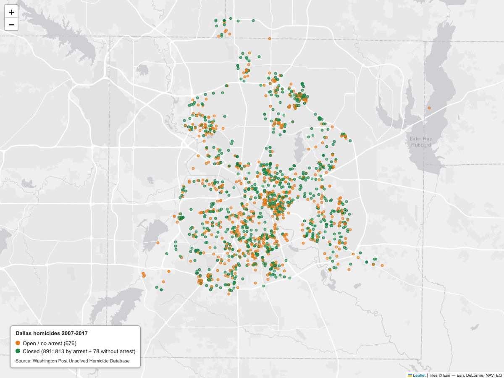

# De-tech-tives

ITSS 3312 squad repo.

- `src/` - package code, one `python -m src.<module>` script per step (see each week below)
- `tests/` - pytest tests, run `pytest` from the repo root
- `data/` - raw inputs
- `reports/` - outputs (CSVs, charts, maps)
- `claudefiles/` - course materials
  - `md/` - weekly supplements, data sources overview, build roadmap
  - `pptxs/` - weekly lecture decks

Each week, add the new supplement `.md` files to `claudefiles/md/` and the new decks to `claudefiles/pptxs/`.

## Setup

```
python -m venv .venv
.venv\Scripts\Activate.ps1
pip install -r requirements.txt
```

## Week 9: Dallas clearance series

### Rebuild everything (Mac/Linux)

```
python3 -m venv .venv
.venv/bin/pip install -r requirements.txt
.venv/bin/python -m src.get_data         # downloads raw files into data/ (gitignored)
.venv/bin/python -m src.series           # writes reports/dallas_series.csv + sanity checks
.venv/bin/python -m src.series_stretch   # optional stretch outputs in reports/
.venv/bin/python -m pytest
```

### Definitions

- **FBI "cleared"** (used in `reports/dallas_series.csv`) = arrest **or** exceptional clearance.
- **WaPo "Closed by arrest"** = arrest only.

### Data sources

- Murder Accountability Project, UCR homicide and clearance data (UCR65_25), murderdata.org, accessed 2026-11-04.
- The Washington Post, Unsolved Homicide Database, github.com/washingtonpost/data-homicides, 2018 (license CC BY-NC-SA 4.0).

See `reports/SOURCES.md` for details.

## Week 10: The Picture

### Rebuild (after `src.get_data` and `src.series`)

```
.venv/bin/python -m src.charts           # reports/clearance_trend.png (+ _rolling.png)
.venv/bin/python -m src.casemap          # reports/dallas_map.html (+ dallas_map_age.html, area table)
.venv/bin/python -m src.map_screenshot   # optional: reports/dallas_map.png (needs Chrome + internet)
.venv/bin/python -m pytest
```

### What each artifact shows

- **`reports/clearance_trend.png`** (for a newsroom): Dallas Police Department homicide clearance rate for every year 1965-2025, on a 0-100% axis. 2017's jump and 2018's record low are annotated, and 2025 is marked as a partial year. Any missing year would show as a break in the line.
- **`reports/dallas_map.html`** (for a council office): every Washington Post Dallas homicide 2007-2017 as one dot. Orange = open / no arrest; green = closed. The legend gives the counts. The dots have no popups or tooltips.



### Definitions

- **Chart** uses the FBI "cleared" count: arrest **or** exceptional clearance (MAP / FBI UCR).
- **Map** uses Washington Post dispositions: "Open/No arrest" (orange) vs "Closed by arrest" + "Closed without arrest" (both green).

## Week 11: The Tap (live city data)

### Setup (each detective, once)

Get a free app token at dallasopendata.com (My Profile > Edit Profile > Developer Settings > Create New App Token) and put it in `.env` at the repo root. `.env` is gitignored; never commit it.

```
DALLAS_APP_TOKEN=paste_your_token_here
```

### Rebuild

```
.venv/bin/python -m src.fetch_city   # API -> data/raw_incidents.json (cache) -> data/case.db
.venv/bin/python -m src.queries      # three answers + reports/dallas_city_vs_fbi.csv
.venv/bin/python -m pytest
```

`fetch_city` only calls the API when `data/raw_incidents.json` is missing. Delete that file to re-fetch.

### Definition

- **City feed "murder"** = `offincident` contains MURDER or equals HOMICIDE (City of Dallas Police Incidents, `qv6i-rri7`, June 2014 to now).

### Squad slice

The percent of murders in the three southern patrol divisions (Southeast, South Central, Southwest). The Week 10 map showed most WaPo cases in the southern half of the city, and this checks whether that holds in the city's own feed after 2017.

### Reporting gap

For the full years 2015-2024, the city's public feed shows about half (51.5%) of the murders Dallas reported to the FBI. See `reports/dallas_city_vs_fbi.csv`. This is documented, not "fixed" by scaling.
